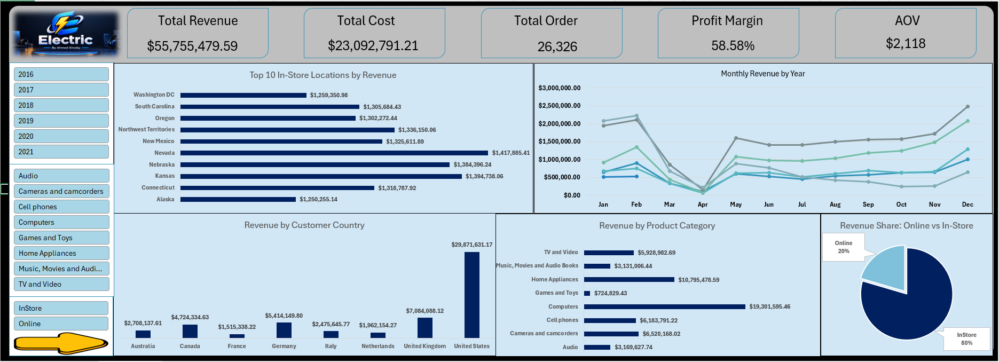
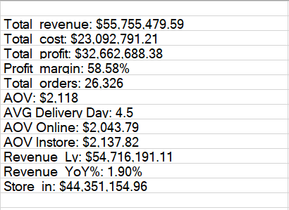

# Global Electronics Retailer – Sales Performance Dashboard

An interactive Excel dashboard built with Power Pivot and DAX to analyze sales performance for a fictional global electronics retailer.

The project explores revenue, gross profit, sales channels, product categories, country performance, physical store locations, and monthly sales trends. The goal is to turn raw sales data into meaningful insights that can support business decisions.

---

## Table of Contents

1. [Business Problem](#1-business-problem)
2. [Business Questions](#2-business-questions)
3. [Dataset and Source](#3-dataset-and-source)
4. [Data Cleaning and Validation](#4-data-cleaning-and-validation)
5. [Data Model](#5-data-model)
6. [Metric Definitions](#6-metric-definitions)
7. [Dashboard Overview](#7-dashboard-overview)
8. [Key Results](#8-key-results)
9. [Key Insights](#9-key-insights)
10. [Business Recommendations](#10-business-recommendations)
11. [Limitations](#11-limitations)
12. [Tools Used](#12-tools-used)
13. [Repository Contents](#13-repository-contents)

---

## 1. Business Problem

The company needed a consolidated view of its sales performance to understand where its revenue and gross profit came from.

The analysis focuses on comparing online and in-store sales, identifying the strongest countries and product categories, evaluating physical store performance, and exploring monthly sales trends.

The objective is to provide a clear overview of business performance and highlight opportunities for improving marketing, inventory planning, and market expansion.

## 2. Business Questions

The project addresses the following business questions:

- What are the total revenue, gross profit, and number of orders?
- Which countries generate the highest revenue?
- Which product categories contribute the most revenue and gross profit?
- How does revenue compare between online and in-store sales?
- Which physical store locations perform best?
- Are there noticeable seasonal patterns or changes in monthly revenue?
- How does sales performance change over time?

## 3. Dataset and Source

The dataset was obtained from the [Global Electronics Retailer dataset](https://mavenanalytics.io/data-playground/global-electronics-retailer), available through the Maven Analytics Data Playground.

The dataset is fictional and was created for analytical practice. It does not represent a real company or real customers.

**Dataset period:** January 1, 2016 – February 20, 2021.

The workbook contains the following tables:

| Table | Rows | Description |
|---|---:|---|
| Sales | 62,884 | Order lines, dates, customers, stores, products, quantities, and currency |
| Customers | 15,266 | Customer information and location |
| Products | 2,517 | Product names, brands, categories, unit costs, and unit prices |
| Store | 67 | 66 physical stores and one online store |
| Calendar | 2,192 | Date table used for time-based analysis |
| Exchange_Rates | 11,215 | Daily exchange rates against USD |
| Data_Dictionary | 37 | Field descriptions and definitions |

The workbook also includes PivotTables and the final dashboard.

**Currency note:** The analysis uses unit prices and unit costs already expressed in USD. Therefore, the Exchange_Rates table was not required for the calculations presented in this project.

## 4. Data Cleaning and Validation

Before building the dashboard, I reviewed the dataset to check data consistency and the relationships between tables.

The following checks were performed:

| Check | Result |
|---|---|
| Data types | Dates, prices, and costs were checked for correct formatting |
| Duplicate records | No duplicate rows or duplicate Order Number + Line Item combinations were identified |
| Referential integrity | Every sales record matched a customer, product, and store |
| Missing delivery dates | 49,719 order lines had blank delivery dates because they represented in-store purchases |
| Missing store size | One blank Square Meters value belonged to the virtual online store |
| State code validation | The code `NA` represented Napoli, Italy, rather than a missing value |
| Price and cost validation | No product had a unit price below its unit cost |

These checks helped establish a consistent foundation for the data model and subsequent analysis.

## 5. Data Model

I built a star-schema data model in Excel Power Pivot.

The Sales table acts as the fact table and connects to the Customers, Products, Store, and Calendar dimension tables through one-to-many relationships.

The model uses the following keys and fields:

- CustomerKey
- ProductKey
- StoreKey
- Order Date

A calculated column named `Delivery Days` was also created to measure delivery time for online orders.

The data model supports the DAX measures and PivotTables used throughout the dashboard.

## 6. Metric Definitions

The following metrics were used to evaluate sales performance:

| Metric | Definition |
|---|---|
| Revenue | Quantity × Unit Price USD |
| Gross Profit | Revenue − (Quantity × Unit Cost USD) |
| Profit Margin | Gross Profit ÷ Revenue |
| Total Orders | Distinct count of Order Number |
| Average Order Value (AOV) | Revenue ÷ Total Orders |
| Sales Channel | Online when StoreKey = 0; otherwise In-Store |
| Delivery Days | Delivery Date − Order Date, for online orders |

Revenue is based on list prices, with no discounts or returns included in the dataset.

Gross profit reflects product costs only. It does not include operating expenses, shipping expenses, or marketing costs.

The measures were created using DAX in the Power Pivot data model.

## 7. Dashboard Overview

The project includes a one-page interactive Excel dashboard designed to provide a quick overview of sales performance.

The dashboard contains five KPI cards:

- Total Revenue
- Total Cost
- Total Orders
- Profit Margin
- Average Order Value

It also includes slicers for Year, Category, and Channel, allowing users to filter the analysis dynamically.

The five charts cover:

1. Revenue by country.
2. Top 10 in-store locations.
3. Revenue by product category.
4. Monthly revenue by year.
5. Online versus in-store revenue share.

The slicers update the dashboard KPIs and charts, making it easier to explore performance across different periods, categories, and sales channels.

For example, when the dashboard is filtered to 2019, total revenue is approximately $18.26 million across 9,083 orders.

## 8. Key Results

The following results are based on the full dataset, covering 2016 through February 2021.

### Overall Performance

| KPI | Result |
|---|---:|
| Total Revenue | $55,755,479.59 |
| Total Gross Profit | $32,662,688.38 |
| Profit Margin | 58.58% |
| Total Orders | 26,326 |
| Average Order Value | $2,118 |
| Online AOV | $2,044 |
| In-Store AOV | $2,138 |
| Average Online Delivery Time | 4.5 days |

### Revenue by Sales Channel

| Channel | Revenue | Revenue Share |
|---|---:|---:|
| In-Store | $44.35M | 79.5% |
| Online | $11.40M | 20.5% |

### Top Countries by Revenue

| Country | Revenue |
|---|---:|
| United States | $29.87M |
| United Kingdom | $7.08M |
| Germany | $5.41M |
| Canada | $4.72M |
| Australia | $2.71M |

### Top Product Categories

| Category | Revenue | Gross Profit |
|---|---:|---:|
| Computers | $19.30M | $11.28M |
| Home Appliances | $10.80M | $6.30M |
| Cameras and Camcorders | $6.52M | $3.92M |
| Cell Phones | $6.18M | $3.50M |
| TV and Video | $5.93M | $3.54M |

## 9. Key Insights

The analysis highlighted several important patterns.

**The United States is the largest market.** It generates approximately $29.87 million in revenue, making it the strongest country in the dataset by a considerable margin.

**Computers are the leading product category.** They generate approximately $19.30 million in revenue and $11.28 million in gross profit, making them the largest contributor among the listed categories.

**In-store sales account for most revenue.** Physical store purchases contribute around 79.5% of total revenue, while online sales account for 20.5%.

**Monthly revenue shows a noticeable seasonal pattern.** Revenue appears strongest around December through February and declines during March and April. April was identified as the weakest month in each year from 2016 to 2020. Further investigation is needed to determine whether this reflects actual seasonality or an issue in the generated dataset.

**Store performance is relatively close among the leading locations.** Nevada ranks first among the listed physical store locations at approximately $1.42 million, followed by Kansas at $1.39 million and Nebraska at $1.38 million.

**Revenue declines during part of 2020.** The reduction compared with 2019 suggests that the period deserves further analysis to understand the timing and possible causes of the decline.

## 10. Business Recommendations

Based on the findings, I would recommend the following actions:

1. **Explore opportunities to grow online sales.** Test targeted online promotions and evaluate their impact on revenue, order volume, and average order value.

2. **Investigate the March–April decline.** Validate the underlying data before making marketing decisions. If the pattern is genuine, consider targeted seasonal campaigns.

3. **Explore growth opportunities outside the United States.** Evaluate customer demand and market potential in the United Kingdom and Germany to identify opportunities for sustainable growth.

4. **Prioritize computer inventory planning.** Since computers contribute the most revenue and gross profit, maintaining appropriate stock levels and product availability may help protect performance.

5. **Investigate the 2020 slowdown.** Compare monthly performance, product categories, and sales channels to identify where the decline was most pronounced.

These recommendations are intended as starting points for further analysis rather than definitive business decisions.

## 11. Limitations

Several limitations should be considered when interpreting the results:

- The dataset is fictional and intended for analytical practice.
- Revenue is based on list prices and does not account for discounts, returns, or taxes.
- Gross profit includes product costs only and excludes operating, shipping, and marketing expenses.
- The 2021 data covers only part of the year, so comparisons with complete years may be misleading.
- The reasons behind the March–April revenue decline and the 2020 slowdown cannot be established from this dataset alone.

## 12. Tools Used

The project was developed using the following tools:

- **Microsoft Excel:** Data preparation, analysis, and dashboard development.
- **Power Pivot:** Data modeling and table relationships.
- **DAX:** Business measures and KPI calculations.
- **PivotTables and PivotCharts:** Summarizing and visualizing sales performance.
- **Slicers:** Interactive filtering across the dashboard.

## 13. Repository Contents

The repository contains the following files and folders:

| File or Folder | Description |
|---|---|
| `My_project.xlsx` | Excel workbook containing the dataset, data model, PivotTables, and dashboard |
| `images/` | Dashboard screenshots, data model, and DAX measure images |
| `README.md` | Project documentation, methodology, results, and recommendations |

To interact with the dashboard, download `My_project.xlsx` and open it in desktop Microsoft Excel on Windows. The workbook's interactive features depend on Excel support for the data model and PivotTables.

GitHub may not display all Excel interactive features directly, so the screenshots in this README provide a visual preview of the analysis.

---

**Data Source:** Maven Analytics Data Playground — Global Electronics Retailer.

## About the Author

**Ahmed Noby | Aspiring Data Analyst**

Interested in turning raw data into meaningful insights through data analysis, visualization, and business reporting.

**Skills demonstrated in this project:**

- Microsoft Excel: PivotTables, Power Pivot, Data Modeling, and Dashboards
- DAX
- Data Cleaning and Validation
- Data Visualization
- Business Reporting
- Power BI
- Google Sheets
